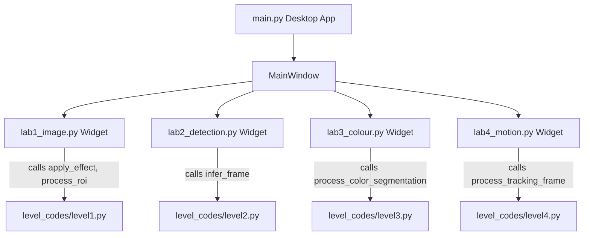

# ARGUS / Pixel Pursuit: Project Architecture & Hinglish Workshop Guide

Welcome to the comprehensive architecture explanation and workshop delivery guide for **ARGUS** (Pixel Pursuit) — the forensic Computer Vision desktop application developed for the **VESIT Computer Vision Workshop by AI CoLegion**.

---

## 1. Project Introduction (प्रोजेक्ट का परिचय)

ARGUS ek desktop-based Computer Vision investigation tool hai jisme students forensic analysis ke zariye OpenCV ke fundamental aur modern concepts seekhte hain.
Workshop ek mystery investigation scenario par structured hai jisme 4 distinct technical stages (Levels) hain:

1. **Level 1 (Image Enhancement & Inspection):** Grayscale conversion, CLAHE (Contrast Limited Adaptive Histogram Equalization), Adaptive / Binary Thresholding, aur configurable ROI (Region of Interest) cropping.
2. **Level 2 (Deep Learning Object Detection):** Real-time inference using Ultralytics YOLO (`yolo11n.pt`), bounding-box parsing, confidence scoring, aur multi-object visual annotation.
3. **Level 3 (Color Segmentation & Filtering):** BGR to HSV color space conversion, dual-range red wraparound mask creation, morphological operations (`cv2.morphologyEx` open/close), aur contour geometry filtering.
4. **Level 4 (Motion Analysis & Object Tracking):** Video frame processing, Euclidean distance centroid matching across consecutive frames, trajectory trail rendering, aur directional tripwire crossing detection.

Sabhi levels **generic upload-driven** hain: students workshop ke bundled Rohan Mehta case evidence (`assets/evidence/`) ke sath-sath apni koi bhi custom image ya video upload karke computer vision pipeline test kar sakte hain.

---

## 2. Real Folder Structure (वास्तविक डायरेक्टरी स्ट्रक्चर)

```
Argus/
├── assets/
│   └── models/
│       └── yolo11n.pt                # YOLOv11 nano PyTorch weights (5.6 MB)
├── level_codes/                      # AUTHORITATIVE OpenCV Teaching Implementations
│   ├── level1.py                     # Level 1: Image Enhancement & ROI Extraction
│   ├── level2.py                     # Level 2: YOLO Inference & Detection Annotation
│   ├── level3.py                     # Level 3: HSV Segmentation, Morphology & Contours
│   └── level4.py                     # Level 4: Centroid Tracking & Tripwire Crossing
├── argus_app/                        # Desktop GUI & Application Framework (PySide6)
│   ├── core/
│   │   ├── __init__.py
│   │   ├── input_source.py           # Unicode-safe image/video streaming helper
│   │   └── pipeline.py               # Frame downscaling & FPS calculation utility
│   ├── evidence/
│   │   ├── __init__.py
│   │   ├── artifacts.py              # Exported evidence image/JSON file saver
│   │   ├── labels.py                 # Stage display label definitions
│   │   └── registry.py               # In-memory evidence registry & disk persistence
│   └── ui/
│       ├── __init__.py
│       ├── main_window.py            # Central desktop window & sidebar navigation
│       ├── style.py                  # Dark-mode forensic theme & CSS stylesheet
│       └── widgets/
│           ├── __init__.py
│           ├── dashboard.py          # 4-stage case landing dashboard
│           ├── evidence_notebook.py  # Recorded findings & notes viewer
│           ├── final_report.py       # Markdown case summary & report exporter
│           ├── settings.py           # Resolution & reset settings dialog
│           ├── lab_base.py           # Reusable UI widgets (MediaTimelineControls, ImageDisplayLabel)
│           ├── lab1_image.py         # Level 1 UI: Upload, effect controls, split viewer
│           ├── lab2_detection.py     # Level 2 UI: Upload, confidence slider, video playback
│           ├── lab3_colour.py        # Level 3 UI: Upload, HSV preset/sliders, live mask view
│           └── lab4_motion.py        # Level 4 UI: Upload, tripwire toggles, trajectory display
├── outputs/                          # Generated outputs & exported evidence
├── docs/                             # Documentation & workshop scripts
├── main.py                           # Official desktop entry point
├── run.py                            # Convenience launcher script
└── requirements.txt                  # Python dependencies
```

---

## 3. Purpose of Every Module & File Audit

### Authoritative Teaching Scripts (`level_codes/`)
Ye 4 files students ke samne open ki jayengi aur code line-by-line explain kiya jayega:
- **[level_codes/level1.py](file:///c:/Users/Puneet/Documents/ChatGPT/Argus/level_codes/level1.py)**:
  - *Purpose:* Complete, standalone image enhancement pipeline. Includes `detect_clock_region()`, `configured_clock_roi()`, `get_default_roi()`, `process_roi()`, aur `apply_effect()`.
  - *CLI Execution:* `python level_codes/level1.py` (saves processed image to `outputs/level1/`).
- **[level_codes/level2.py](file:///c:/Users/Puneet/Documents/ChatGPT/Argus/level_codes/level2.py)**:
  - *Purpose:* YOLOv11 model loading aur frame inference. Contains `infer_frame()` jo raw image par YOLO model chala kar bounding boxes, classes, aur confidence scores draw karta hai aur structured detections list return karta hai.
  - *CLI Execution:* `python level_codes/level2.py` (runs inference on evidence and displays OpenCV window).
- **[level_codes/level3.py](file:///c:/Users/Puneet/Documents/ChatGPT/Argus/level_codes/level3.py)**:
  - *Purpose:* HSV segmentation pipeline. Exposes `COLOR_PRESETS`, `convert_to_hsv()`, `create_color_mask()`, `apply_morphology()`, `find_candidate_contours()`, `draw_candidate_overlay()`, aur unified `process_color_segmentation()`.
  - *CLI Execution:* `python level_codes/level3.py` (segments red objects in video/image).
- **[level_codes/level4.py](file:///c:/Users/Puneet/Documents/ChatGPT/Argus/level_codes/level4.py)**:
  - *Purpose:* Real-time motion and object tracking. Contains `process_tracking_frame()` jo HSV mask ya bright-target segmentation ke zariye contours dhoondhta hai, centroid `(cX, cY)` nikalta hai, trajectory trail maintain karta hai, aur directional tripwire crossing count karta hai.
  - *CLI Execution:* `python level_codes/level4.py` (tracks moving object across corridor video).

### Core Utilities (`argus_app/core/`)
- **[argus_app/core/input_source.py](file:///c:/Users/Puneet/Documents/ChatGPT/Argus/argus_app/core/input_source.py)**:
  - Unicode-safe file loader using `np.fromfile` aur `cv2.imdecode` taaki Windows path me special characters se crash na ho. `InputSource` class unified image aur video reading stream provide karti hai.
- **[argus_app/core/pipeline.py](file:///c:/Users/Puneet/Documents/ChatGPT/Argus/argus_app/core/pipeline.py)**:
  - Performance utilities: `downscale_frame()` for high-DPI video scaling aur `FPSCounter` real-time playback monitoring ke liye.

### Evidence System (`argus_app/evidence/`)
- **[argus_app/evidence/artifacts.py](file:///c:/Users/Puneet/Documents/ChatGPT/Argus/argus_app/evidence/artifacts.py)**:
  - Exports logged findings, screenshots, and metadata to `outputs/` folder with proper timestamps.
- **[argus_app/evidence/registry.py](file:///c:/Users/Puneet/Documents/ChatGPT/Argus/argus_app/evidence/registry.py)**:
  - Stores captured investigation evidence across levels in memory and persists to disk as JSON.
- **[argus_app/evidence/labels.py](file:///c:/Users/Puneet/Documents/ChatGPT/Argus/argus_app/evidence/labels.py)**:
  - Friendly display titles for case artifacts and clues.

### UI Screens & Widgets (`argus_app/ui/widgets/`)
All UI files are strictly presentation and interaction layers — **they contain ZERO duplicate computer vision algorithms**:
- **[argus_app/ui/widgets/lab_base.py](file:///c:/Users/Puneet/Documents/ChatGPT/Argus/argus_app/ui/widgets/lab_base.py)**:
  - Shared UI components: `ImageDisplayLabel` (drag-and-drop file upload target), `MediaTimelineControls` (play/pause/seek bar), aur `LabWidget` (Qt image conversion utilities).
- **[argus_app/ui/widgets/dashboard.py](file:///c:/Users/Puneet/Documents/ChatGPT/Argus/argus_app/ui/widgets/dashboard.py)**:
  - Welcome screen showing case briefing, suspects, and cards for jumping directly to any of the 4 unlocked levels.
- **[argus_app/ui/widgets/evidence_notebook.py](file:///c:/Users/Puneet/Documents/ChatGPT/Argus/argus_app/ui/widgets/evidence_notebook.py)**:
  - Digital notebook where user can review recorded snapshots, clues, and timestamps.
- **[argus_app/ui/widgets/final_report.py](file:///c:/Users/Puneet/Documents/ChatGPT/Argus/argus_app/ui/widgets/final_report.py)**:
  - Formulates final murder mystery report, suspect evaluation, and markdown export.
- **[argus_app/ui/widgets/settings.py](file:///c:/Users/Puneet/Documents/ChatGPT/Argus/argus_app/ui/widgets/settings.py)**:
  - Performance settings: frame downscaling resolution toggle and notebook reset.
- **[argus_app/ui/widgets/lab1_image.py](file:///c:/Users/Puneet/Documents/ChatGPT/Argus/argus_app/ui/widgets/lab1_image.py)**:
  - Level 1 UI: Handles image upload, effect dropdown (Grayscale, CLAHE, Threshold), ROI selection, zoom slider, side-by-side comparison, and calls `level_codes.level1`.
- **[argus_app/ui/widgets/lab2_detection.py](file:///c:/Users/Puneet/Documents/ChatGPT/Argus/argus_app/ui/widgets/lab2_detection.py)**:
  - Level 2 UI: Handles image/video upload, model path selection, confidence threshold slider, asynchronous video playback worker, and invokes `level_codes.level2.infer_frame()`.
- **[argus_app/ui/widgets/lab3_colour.py](file:///c:/Users/Puneet/Documents/ChatGPT/Argus/argus_app/ui/widgets/lab3_colour.py)**:
  - Level 3 UI: Handles image/video upload, color preset dropdown (Red, Blue, Green, Yellow, Orange), 6 HSV range sliders, morphological kernel slider, dual live displays (Annotated View + Mask View), and calls `level_codes.level3.process_color_segmentation()`.
- **[argus_app/ui/widgets/lab4_motion.py](file:///c:/Users/Puneet/Documents/ChatGPT/Argus/argus_app/ui/widgets/lab4_motion.py)**:
  - Level 4 UI: Handles video upload, color preset selector, min-area slider, tripwire direction toggle (Left-to-Right / Right-to-Left / Bidirectional), live trajectory trail display, and calls `level_codes.level4.process_tracking_frame()`.

---

## 4. UI to Level Scripts Integration Architecture

UI aur Computer Vision algorithms ke beech bilkul clean direct-import separation hai:



### Specific Integration Calls:
1. **Level 1 (`lab1_image.py`):**
   ```python
   from level_codes.level1 import (
       apply_effect,
       get_default_roi,
       process_roi,
   )
   # UI passes image array, effect name, and ROI rectangle directly:
   processed = apply_effect(image, effect_name, clahe_clip_limit=2.0, threshold_value=128)
   crop_preview = process_roi(image, effect_name, region=(x, y, w, h), zoom=zoom_level)
   ```
2. **Level 2 (`lab2_detection.py`):**
   ```python
   from level_codes.level2 import infer_frame
   # In video worker or static image pass:
   annotated_frame, detections = infer_frame(self.model, frame, confidence=conf_threshold)
   ```
3. **Level 3 (`lab3_colour.py`):**
   ```python
   from level_codes.level3 import COLOR_PRESETS, process_color_segmentation
   # UI passes HSV slider bounds and morphological parameters:
   results = process_color_segmentation(
       frame, h_min, h_max, s_min, s_max, v_min, v_max,
       morph_kernel=kernel_size, min_area=min_area
   )
   annotated_frame = results["result"]
   cleaned_mask = results["mask_cleaned"]
   candidate_regions = results["candidate_regions"]
   ```
4. **Level 4 (`lab4_motion.py`):**
   ```python
   from level_codes.level4 import process_tracking_frame
   # Frame-by-frame persistent tracking across worker threads:
   res = process_tracking_frame(
       frame, previous_centroid=prev_c, trail=trail, segments=segments,
       line_x=line_x, crossing_direction=mode, min_area=min_area,
       h_min=h_min, h_max=h_max, s_min=s_min, s_max=s_max, v_min=v_min, v_max=v_max
   )
   annotated_frame = res["result"]
   current_centroid = res["centroid"]
   has_crossed = res["crossed"]
   updated_trail = res["trail"]
   ```

---

## 5. Logical-Block Walkthrough of OpenCV Levels

### Level 1: `level_codes/level1.py`
- **Grayscale Conversion (`cv2.cvtColor`):**
  Color image (3 channels: Blue, Green, Red) ko single luminance channel me convert karta hai. Luminance formula: $Y = 0.299R + 0.587G + 0.114B$. Pixel intensities 0 se 255 ke beech aati hain, computing load 3x kam ho jata hai.
- **CLAHE (`cv2.createCLAHE`):**
  Contrast Limited Adaptive Histogram Equalization. Normal histogram equalization poore image ko over-brighten kar deta hai jisse noise amplify ho jati hai. CLAHE image ko chote rectangular grids (tiles, e.g. 8x8) me divide karta hai aur har tile ka local histogram equalize karta hai. `clipLimit=2.0` se contrast slope cap rehta hai taaki dark CCTV frame me hidden clock digits bina noise ke pop out ho sakein.
- **Thresholding (`cv2.threshold`):**
  Binarization technique jisme har pixel agar threshold value (e.g. 128) se bada ho toh 255 (white) ho jata hai, varna 0 (black). Clock numbers crisp black & white glyphs ban jate hain.
- **ROI Extraction (`image[y:y+h, x:x+w]`):**
  Numpy slicing ke zariye frame ke specific bounding box ko crop karta hai. Is crop ko `cv2.resize(..., interpolation=cv2.INTER_NEAREST)` se 5x zoom kiya jata hai taaki pixels blur na hon balki sharp blocks me dikhein.

### Level 2: `level_codes/level2.py`
- **Ultralytics YOLO Architecture:**
  Single-stage convolutional neural network jo image ko single forward pass me inspect karke direct bounding box coordinates $[x_1, y_1, x_2, y_2]$, class IDs, aur confidence scores ($0.0 \to 1.0$) predict karta hai.
- **Inference Pipeline (`infer_frame`):**
  `model.predict(source=frame, conf=0.25, verbose=False)` call hota hai.
  Results tensor se coordinates extract hote hain: `boxes.xyxy.cpu().numpy().astype(int)`.
- **Visual Annotation (`cv2.rectangle`, `cv2.putText`):**
  Detection coordinate par colored box draw hota hai aur class label ke sath confidence percentage (e.g. `person 88%`, `backpack 74%`, `sports ball 65%`) render hoti hai.

### Level 3: `level_codes/level3.py`
- **BGR to HSV Conversion (`cv2.cvtColor(image, cv2.COLOR_BGR2HSV)`):**
  RGB/BGR me color lighting aur shadows se drastically shift hota hai. HSV color space me:
  - **H (Hue):** 0 se 179 (Actual color tone, e.g. 0-10=Red, 60=Green, 120=Blue).
  - **S (Saturation):** 0 se 255 (Color kitna pure / vivid hai).
  - **V (Value):** 0 se 255 (Brightness).
- **Dual-Range Red Wraparound:**
  Red color Hue wheel ke bilkul boundary par wrap around hota hai ($0^\circ$ and $360^\circ$, OpenCV me $0-10$ aur $170-179$). Isliye do masks banate hain:
  - Lower range: `[0, S_min, V_min]` to `[10, S_max, V_max]`
  - Upper range: `[170, S_min, V_min]` to `[179, S_max, V_max]`
  - Bitwise OR: `mask = cv2.bitwise_or(mask1, mask2)`
- **Morphological Operations (`cv2.morphologyEx`):**
  - **Opening (`cv2.MORPH_OPEN`):** Erosion followed by Dilation. Background me aane wale isolated specks/salt noise ko gayab kar deta hai.
  - **Closing (`cv2.MORPH_CLOSE`):** Dilation followed by Erosion. Target object ke andar ke chote gaps aur black holes ko fill kar deta hai.
- **Contour Detection & Geometry Filtering (`cv2.findContours`):**
  Binary mask ke boundaries trace karta hai (`cv2.RETR_EXTERNAL`, `cv2.CHAIN_APPROX_SIMPLE`). Area filter (`cv2.contourArea(cnt) > min_area`) se chote artifacts ignore hote hain aur genuine candidate targets par bounding box draw hoti hai.

### Level 4: `level_codes/level4.py`
- **Centroid Calculation via Moments (`cv2.moments`):**
  Contour ke spatial moments nikal kar center of mass calculate hota hai:
  $$cX = \frac{M_{10}}{M_{00}}, \quad cY = \frac{M_{01}}{M_{00}}$$
- **Temporal Association (Tracking):**
  Frame $N$ ke centroid ko Frame $N-1$ ke centroid se associate karte hain using Euclidean distance:
  $$\text{dist} = \sqrt{(cX_2 - cX_1)^2 + (cY_2 - cY_1)^2}$$
  Agar distance jump threshold se kam ho, toh wahi moving object identify rehta hai.
- **Trajectory Trail Rendering:**
  Centroid coordinates ko ek fixed-length queue (`collections.deque(maxlen=32)`) me append karte hain. Consecutive points ke beech `cv2.line` draw hoti hai jisme older points progressively thinner aur fade hote hain.
- **Directional Tripwire Crossing:**
  Screen par vertical line $X = \text{line\_x}$ define hoti hai.
  - **Left-to-Right:** Agar $cX_{\text{prev}} < X_{\text{line}}$ aur $cX_{\text{curr}} \ge X_{\text{line}}$.
  - **Right-to-Left:** Agar $cX_{\text{prev}} > X_{\text{line}}$ aur $cX_{\text{curr}} \le X_{\text{line}}$.
  Crossing detect hote hi boundary event count trigger hota hai aur on-screen visual confirmation render hoti hai.

---

## 6. Complete Spoken Hinglish Presentation Script (प्रस्तुति स्क्रिप्ट)

> **Presenter Guide:** Use this script verbatim or naturally adapt it during the workshop. Each section has clear visual and interactive markers.

### Stage 0: Welcome & Case Briefing
- **SHOW:** ARGUS Dashboard (`python main.py`). Show the dark forensic interface and the 4 stage tiles.
- **SAY:** *"Good morning everyone! Welcome to Pixel Pursuit — ARGUS Computer Vision Workshop by AI CoLegion. Aaj hum computer vision ko kisi boring theoretical lecture ki tarah nahi, balki ek real-world forensic crime investigation ki tarah seekhenge. Scenario simple hai: VESIT Robotics Lab me ek murder hua hai. Victim hai Rohan Mehta. Police ko lab aur campus CCTV se 4 critical digital evidence mile hain, lekin footage dark hai, low quality hai, aur corrupted hai. Aaj hum OpenCV aur Deep Learning use karke iss footage ko forensic level par process karenge aur killer ko uncover karenge!"*
- **EXPLAIN:** *"ARGUS ka poora codebase modular aur transparent hai. Har ek stage ka complete, clean computer vision algorithm `level_codes/` folder ke andar hai. UI sirf controls aur display handle karta hai, saara real vision logic pure OpenCV aur PyTorch me likha hai."*
- **DEMO:** Dashboard par Level 1 card par click karein.

---

### Stage 1: Level 1 — Image Enhancement & CLAHE
- **SHOW:** Screen par Level 1 UI open karein. Side-by-side view me dark CCTV image `EVIDENCE-01.png` dikhayein.
- **SAY:** *"Sabse pehle case ka starting point: Crime scene ka time establish karna. Evidence 1 ek dark CCTV camera frame hai. Is frame ke top-right corner me ek wall clock hai, lekin image itni dark hai ki clock digits bilkul invisible hain."*
- **EXPLAIN:** Open `level_codes/level1.py` in VS Code / IDE.
  *"OpenCV me kisi bhi dark image ko enhance karne ke liye hum teen steps follow karte hain:
  Pehla: `cv2.cvtColor(image, cv2.COLOR_BGR2GRAY)`. Color information forensic enhancement ke liye zaroori nahi hoti, grayscale se computation 3 times fast ho jata hai.
  Doosra: `cv2.createCLAHE(clipLimit=2.0, tileGridSize=(8,8))`. Normal histogram equalization poore frame ko overexpose kar deta hai jisse background me white noise bhar jati hai. CLAHE image ko 8x8 ke chote tiles me baant kar locally contrast amplify karta hai.
  Teesra: `cv2.threshold()`. Isse hum faint LED segments ko solid white aur dark background ko pure black bana dete hain."*
- **DEMO:**
  1. UI me "Effect" dropdown se **CLAHE** select karein. Dikhayein ki room details visible ho gayi hain.
  2. "Threshold" select karein.
  3. "ROI Target" me Clock select karein ya custom box drag karein.
  4. Right side zoom preview me sharp, enhanced clock digits dikhayein: **"Time: 21:42 (9:42 PM)"**.
  5. Click **"Log Finding"** button.

---

### Stage 2: Level 2 — Deep Learning Object Detection (YOLO)
- **SHOW:** Level 2 UI open karein. Video evidence `EVIDENCE-02.mp4` load karein.
- **SAY:** *"Ab hume pata chal gaya ki crime raat ke 9:42 PM par hua tha. Next evidence hai corridor CCTV camera ki footage. Yahan corridor me suspects walk kar rahe hain. Lekin manual monitoring me human error ho sakta hai. Isliye hum use karenge Modern Computer Vision ka gold standard: YOLO — You Only Look Once."*
- **EXPLAIN:** Open `level_codes/level2.py`.
  *"YOLO ek single-stage deep neural network hai. Traditional vision me pehle regions propose hote the, fir classify hote the, jo bohot slow tha. YOLO poore frame ko ek sath inspect karta hai aur ek hi forward pass me bounding boxes $[x_1, y_1, x_2, y_2]$, class names jaise 'person', 'backpack', aur confidence score calculate karta hai.
  Humare code me function dekhiye: `infer_frame(model, frame, confidence=0.25)`. Ultralytics engine bounding boxes predict karta hai aur hum `cv2.rectangle` aur `cv2.putText` se frame par live annotations draw karte hain."*
- **DEMO:**
  1. Click **Play**. Real-time me bounding boxes animate hote hue dikhayein: `person (91%)`, `backpack (84%)`.
  2. Confidence slider ko $0.25$ se $0.60$ move karke dikhayein ki weak detections drop ho jati hain aur genuine suspects retain hote hain.
  3. Ek custom image upload karke dikhayein ki YOLO generic inputs par bhi seamlessly kaam karta hai.
  4. Click **"Log Finding"** to save detected suspect frames to the Evidence Notebook.

---

### Stage 3: Level 3 — Color Segmentation & HSV Thresholding
- **SHOW:** Level 3 UI open karein. Video `EVIDENCE-03.mp4` load karein.
- **SAY:** *"Witness statement ke according ek suspect red hoodie ya red bag carry kar raha tha, aur campus se ek red vehicle escape hui. Hum exact red colored objects ko isolate aur track karna chahte hain. Lekin standard RGB/BGR format me color filtering practically fail ho jati hai — kyu? Kyunki light badalte hi RGB values drastically change ho jati hain!"*
- **EXPLAIN:** Open `level_codes/level3.py`.
  *"Isliye step 1 hai: `cv2.cvtColor(frame, cv2.COLOR_BGR2HSV)`. HSV me H (Hue) color batata hai, S (Saturation) color ki purity, aur V (Value) lighting ko isolate karta hai.
  Ab ek important OpenCV interview question: Red color Hue scale (0 to 180) ke dono ends par exist karta hai ($0-10$ aur $170-179$). Isliye hum do masks banate hain:
  `mask1 = cv2.inRange(hsv, [0, S, V], [10, 255, 255])`
  `mask2 = cv2.inRange(hsv, [170, S, V], [179, 255, 255])`
  Aur dono ko combine karte hain: `cv2.bitwise_or(mask1, mask2)`.
  Iske baad hum run karte hain Morphological Operations:
  `cv2.morphologyEx(mask, cv2.MORPH_OPEN)` jo isolated false pixels ko hatata hai, aur `MORPH_CLOSE` jo object ke gaps ko fill karta hai.
  Finally `cv2.findContours()` se hum continuous red boundaries isolate karte hain."*
- **DEMO:**
  1. UI me "Color Preset" me **Red** select karein.
  2. "Processed View" me target vehicle ke upar green bounding box aur centroid point dikhayein.
  3. UI ka **"Mask View"** toggle switch on karein — students ko live binary mask dikhayein jisme sirf red car white glow karti hai aur baaki poora scene black ho jata hai.
  4. Sliders adjust karke dikhayein ki kaise noise control hoti hai.
  5. Click **"Log Finding"**.

---

### Stage 4: Level 4 — Motion Analysis, Trajectory & Tripwire
- **SHOW:** Level 4 UI open karein. Video `EVIDENCE-04.mp4` load karein.
- **SAY:** *"Final stage: Suspect ka movement vector aur exit timing confirm karna. Hum calculate karenge ki suspect kis direction me move hua aur corridor ke virtual tripwire ko kis exact second par cross kiya."*
- **EXPLAIN:** Open `level_codes/level4.py`.
  *"Iss stage me teen sequential vision algorithms kaam karte hain:
  1. **Moments & Centroid:** `cv2.moments(contour)` use karke hum formula lagate hain: $cX = M_{10}/M_{00}, cY = M_{01}/M_{00}$. Yeh hume moving target ka geometric center deta hai.
  2. **Trajectory Trail:** Hum consecutive centroids ko ek circular buffer (`deque`) me store karte hain. Har do consecutive frames ke beech `cv2.line` draw karke smooth fading movement path render karte hain.
  3. **Tripwire Crossing Logic:** Screen ke beech me ek vertical reference line hoti hai ($X = \text{line\_x}$). Agar previous frame me suspect left me tha ($cX_{\text{prev}} < X$) aur current frame me right me chala gaya ($cX_{\text{curr}} \ge X$), toh yeh genuine crossing event hai!"*
- **DEMO:**
  1. Click **Play**. Suspect ke move hone par blue centroid point aur green fading trajectory trail dikhayein.
  2. Jaise hi suspect yellow tripwire line ko cross karta hai:
     - Line momentarily red/green flash karegi.
     - "Crossing Count" increment hoke **1** ho jayega.
     - Status me direction print hogi: **"Direction: LEFT -> RIGHT"**.
  3. Click **"Log Finding"**.

---

### Stage 5: Investigation Conclusion & Final Report
- **SHOW:** Navigate to **Evidence Notebook** and then to **Final Report**.
- **SAY:** *"Sabhi 4 stages complete hone ke baad hamara evidence notebook ready hai. Humne Level 1 se crime time establish kiya (9:42 PM), Level 2 se suspect ko identify kiya, Level 3 se suspect ki red vehicle isolate ki, aur Level 4 se verify kiya ki suspect lab exit corridor cross karke bhaga.
  Ab 'Final Report' tab me generate button par click karke complete forensic investigation summary export kar sakte hain!"*
- **DEMO:**
  1. Final Report screen me "Generate Report" click karein.
  2. Structured Markdown table, timestamps, aur suspect evaluation display karein.
  3. "Export Report" button click karke file ko `outputs/` me save karein.

---

## 7. Likely Student Questions & Clear Answers (छात्रों के संभावित प्रश्न और उत्तर)

### Q1: BGR aur RGB me kya farak hai? OpenCV BGR kyu use karta hai?
**Answer:** RGB aur BGR me channel ordering ka difference hota hai — RGB me red pehla channel hota hai, jabki BGR me blue pehla channel hota hai. 1990s me jab early camera sensors aur frame grabber cards design ho rahe the, tab hardware manufacturers (jaise Sony aur Intel) byte order memory efficiency ke liye Blue channel ko pehle store karte the. OpenCV 1.0 usi hardware ecosystem me develop hua tha, isliye historical compatibility maintain karne ke liye OpenCV aaj bhi by default images ko BGR format me read karta hai.

### Q2: Normal Histogram Equalization ke bajay CLAHE kyu use karte hain?
**Answer:** Standard `cv2.equalizeHist()` poore image ki global intensity distribution ko stretch karta hai. Agar image me ek dark corner hai aur ek bright bulb hai, toh global equalization dark areas me digital noise amplify kar dega aur bright areas wash out kar dega. CLAHE (Contrast Limited Adaptive Histogram Equalization) image ko chote 8x8 blocks (tiles) me divide karta hai aur har tile ka local histogram equalize karta hai. Saath hi ek `clipLimit` threshold apply karta hai jisse noise amplification strictly suppress rehti hai.

### Q3: Color detection ke liye RGB ke bajay HSV kyu prefer kiya jata hai?
**Answer:** RGB color space me color (chromaticity) aur roshni (luminance/brightness) aapas me mixed hote hain. Agar room ki light thodi dim ho jaye ya shadow pad jaye, toh red color ki R, G, B teeno values drastically change ho jati hain. Lekin HSV color space me:
- **H (Hue)** batata hai actual color angle ($0^\circ \to 360^\circ$).
- **S (Saturation)** batata hai color ki depth.
- **V (Value)** batata hai illumination.
Light kam ya zyada hone par sirf V value change hoti hai, Hue lagbhag constant rehta hai. Isliye shadows aur lighting variations ke bawajood HSV me color detection bohot stable rehta hai.

### Q4: Red color ke liye do HSV ranges kyu banani padti hain?
**Answer:** Hue wheel ek circular 360-degree color spectrum hota hai. Red color $0^\circ$ ke dono sides wrap hota hai ($350^\circ$ se $10^\circ$). OpenCV me 8-bit image memory limit (0 to 255) ki wajah se $0^\circ-360^\circ$ angles ko 2 se divide karke $0$ se $179$ ki range me store kiya jata hai. Is scaling ki wajah se Red ka ek hissa $0-10$ par fall karta hai aur doosra hissa $170-179$ par. In dono ranges ko capture karne ke liye do alag masks banakar `cv2.bitwise_or()` se combine karna zaroori hota hai.

### Q5: Morphological Opening aur Closing me kya difference hai?
**Answer:**
- **Opening:** Pehle `Erosion` hota hai fir `Dilation`. Erosion boundary pixels ko shrink karta hai jisse chote isolated noise dots gayab ho jate hain, fir dilation remaining real object ko wapas uske original size par restore kar deta hai. (*Formula: Removes foreground noise*).
- **Closing:** Pehle `Dilation` hota hai fir `Erosion`. Dilation object ke internal black gaps aur holes ko fill kar deta hai, fir erosion shape ko wapas normal size par restrict karta hai. (*Formula: Fills internal holes*).

### Q6: Centroid calculate karne me Image Moments ($M_{10}, M_{00}$) kya hote hain?
**Answer:** Physics me jaise Center of Mass nikalne ke liye mass moments use hote hain, computer vision me pixel intensity moments use hote hain:
- $M_{00}$ contour ke total pixels ka sum (area) hota hai.
- $M_{10}$ contour ke sabhi pixels ke $X$-coordinates ka sum hota hai.
- $M_{01}$ contour ke sabhi pixels ke $Y$-coordinates ka sum hota hai.
Isliye $cX = \frac{M_{10}}{M_{00}}$ horizontal mean position deta hai aur $cY = \frac{M_{01}}{M_{00}}$ vertical mean position deta hai.

### Q7: YOLOv11 nano model (`yolo11n.pt`) lightweight kyu hai aur CPU par kaise fast chalta hai?
**Answer:** YOLOv11n ultralight parameters (~2.6M parameters) aur efficient convolution layers (C3k2 blocks aur SPPF) use karta hai. Iska weight file size sirf ~5.6 MB hai. Frame ko resize karke $640 \times 640$ matrix par pass kiya jata hai jisse normal laptops ke integrated Intel/AMD CPU par bhi bina dedicated GPU ke 20-30 FPS ki interactive speed mil jati hai.

---

## 8. Setup & Execution Commands (रन करने के कमांड्स)

### 1. Environment Setup
```bash
# Clone and enter project directory
cd Argus

# Install required dependencies
pip install -r requirements.txt
```

### 2. Run Desktop GUI Application
```bash
# Official launcher
python main.py

# Or convenience wrapper
python run.py
```

### 3. Run Standalone Authoritative Teaching Scripts
Har teaching file ko directly CLI se bina GUI ke run kiya ja sakta hai:

```bash
# Level 1: Image enhancement & clock ROI extraction
python level_codes/level1.py

# Level 2: YOLO object detection on video/image
python level_codes/level2.py

# Level 3: HSV color segmentation
python level_codes/level3.py

# Level 4: Centroid tracking & tripwire crossing
python level_codes/level4.py
```

---
*Created for the Pixel Pursuit OpenCV Workshop by AI CoLegion at VESIT.*
